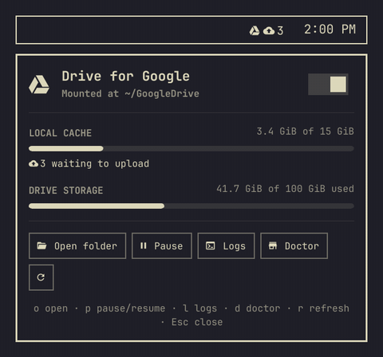
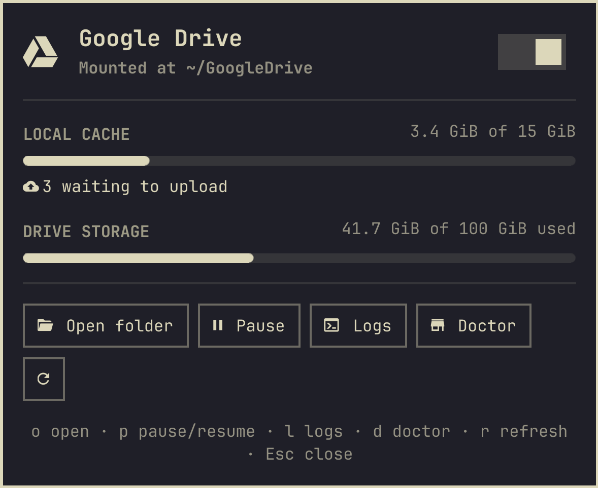
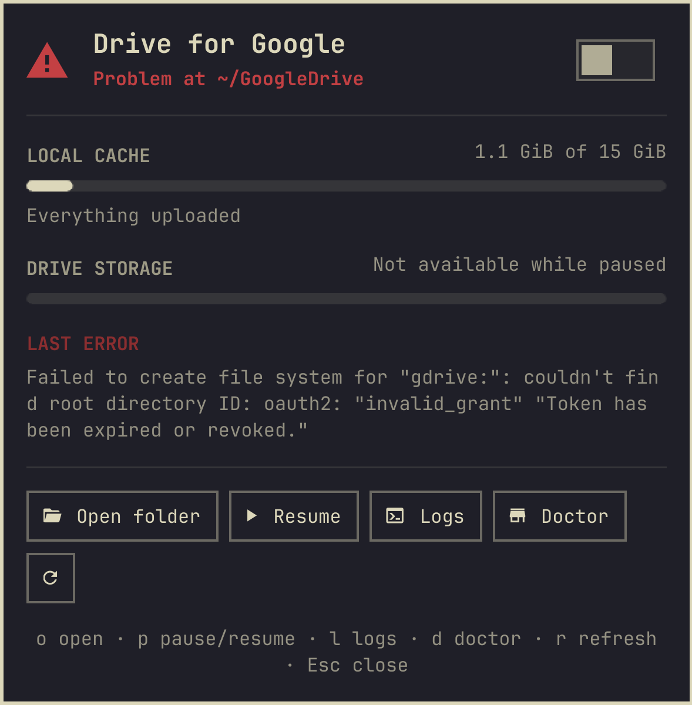

# Drive for Google

**🇺🇸 English** · [🇧🇷 Português (Brasil)](README.pt-BR.md)

Your Google Drive on [Omarchy](https://omarchy.org), done right: your own OAuth client, an
`rclone` mount that survives reboots, a `doctor` that tells you what is wrong, and a bar
widget to watch it. One guided command sets it all up, and running it again only changes
what differs.

Not affiliated with Google. Google Drive is a trademark of Google LLC.

<p align="center"></p>

## What you get

- **`omarchy-gdrive setup`** — one guided, idempotent command. Installs `rclone` if missing (the only thing that ever runs as root, and only after you say yes), walks you through creating **your own Google OAuth client**, signs you in, writes a systemd *user* unit with sane VFS-cache defaults, mounts `~/GoogleDrive` and adds it to the file manager sidebar. Run it again any time; it only changes what differs.
- **Adopts what you already have.** Mounted Drive by hand with your own `rclone-gdrive.service`? `setup` detects it and offers to *adopt* it untouched (default) or replace it with the template.
- **`omarchy-gdrive doctor`** — tools, config permissions, remote, own vs. shared `client_id`, network, token, unit, mount, cache, pending uploads, bookmark. Says what to run to fix each thing. `--fix` applies the safe ones.
- **`status`, `start`, `stop`, `restart`, `logs`, `quota`, `open`, `remove`** — and `status --json` for machines.
- **Bar widget** — state icon (mounted / paused / problem), pending-upload badge, popup with cache usage, Drive quota, pause/resume switch, logs and doctor buttons. Follows the Omarchy theme live. Click opens `~/GoogleDrive`.
- **No secrets in the wrong place.** The `client_secret` is written straight into `~/.config/rclone/rclone.conf` (mode 600), never passed on a command line, never logged, never shown in the widget. See [Privacy and security](#privacy-and-security).
- **English and Portuguese**, following the Omarchy language setting (falls back to `$LANG`).

<p align="center">
  
  
</p>
<p align="center">
  
</p>
<p align="center"><sub>Screenshots and the demo use mock data from the dev harness (<code>dev/run.sh docs</code>, <code>dev/run.sh gif</code>), not a real account.</sub></p>

## Install

```bash
omarchy plugin add https://github.com/gusthanks/omarchy-gdrive.git --enable
~/.config/omarchy/plugins/gusthx.gdrive/bin/omarchy-gdrive setup
```

Requirements: Omarchy (Arch Linux), and `rclone`, `fuse3` and `jq`, which `setup`
offers to install with `pacman` (it shows the command and asks first).

`setup` links the CLI into `~/.local/bin`, so from then on it is just `omarchy-gdrive …`. Pick **right** when the plugin asks where to place the widget.

Don't want the widget? Clone the repo anywhere and run `bin/omarchy-gdrive setup`; the CLI has no dependency on the shell.

### What `setup` does, step by step

1. If `rclone`, `fuse3` or `jq` are missing, shows the exact command (`sudo pacman -S --needed --noconfirm …`) and asks before running it. `--yes` answers for you; without a terminal and without `--yes`, nothing is installed.
2. Looks for an existing `~/.config/systemd/user/rclone-gdrive.service`. If you wrote one, it offers **Adopt** (nothing changes, nothing restarts) or **Replace**.
3. Creates (or reuses) the rclone remote `gdrive`. If you downloaded a `client_secret_*.json` from Google it finds it in `~/Downloads` and asks to use it. Otherwise it explains [why you want your own client](docs/own-client-id.md) and lets you paste the id and secret, or continue with rclone's shared client for now.
4. Opens the browser once for Google's consent screen (`rclone config reconnect`).
5. Writes the unit from [`templates/rclone-gdrive.service`](templates/rclone-gdrive.service):
   `--vfs-cache-mode full`, cache capped at 10 % of the free space on the cache disk (2–50 GiB), `--vfs-cache-max-age 72h`, `--dir-cache-time 72h`, `--poll-interval 1m`, `--umask 022`, `After=network-online.target`, auto-restart.
6. `systemctl --user enable --now`, waits for the mount, adds the GTK bookmark, `chmod 600 rclone.conf`.

Everything is recorded in `~/.config/omarchy-gdrive/config` (remote, mount point, unit name, adopted or managed).

## Why your own `client_id`

rclone ships with one shared Google `client_id` used by every rclone user on Earth. Google throttles it (hello `rateLimitExceeded`) and is **retiring it during 2026**. Creating your own takes five minutes, is free, and gives you a private quota. The guide walks through the Google Cloud Console click by click:

➡️ **[docs/own-client-id.md](docs/own-client-id.md)** · 🇧🇷 [em português](docs/own-client-id.pt-BR.md)

Already mounted with the shared client? `omarchy-gdrive setup --client` upgrades the existing remote in place.

## Use

### Commands

| Command | What it does |
|---|---|
| `setup` | Guided install / repair. `--client`, `--credentials FILE`, `--shared-client`, `--adopt`, `--replace`, `--remote`, `--mountpoint`, `--service`, `--yes` |
| `status [--json]` | One screen: state, service, remote, cache, pending uploads |
| `doctor [--fix]` | Full health check with fixes to run; exit 1 only on real failures |
| `start` / `stop` / `restart` | Mount, unmount (warns about pending uploads), remount |
| `logs [-n N] [--no-follow]` | `journalctl --user -u rclone-gdrive -f` |
| `quota [--json]` | Drive usage (`rclone about`) |
| `open` | Open the mount in the file manager |
| `remove [--keep-remote] [--purge-cache]` | Undo everything on this machine. **Never touches files on Drive.** |

### Bar widget

| Action | Result |
|---|---|
| Left click | Open `~/GoogleDrive` |
| Right click | Open the menu |
| Middle click | Pause / resume the mount |
| Keys in the menu | `o` open · `p` pause/resume · `l` logs · `d` doctor · `r` refresh · `Esc` close |

## Configuration

Prefer the menu on left click? In `~/.config/omarchy/shell.json`:

```json
{ "id": "gusthx.gdrive", "leftClick": "panel" }
```

The widget refreshes every 15 s (every 4 s while the menu is open); set `"pollSeconds"` to change it (minimum 3). Each refresh is cheap: `status` reads the rclone config only when `rclone.conf` changed, and keeps just two yes/no facts (remote exists, own client) in `$XDG_RUNTIME_DIR`, never a token.

IPC: `quickshell -p /usr/share/omarchy/shell ipc call gusthx.gdrive toggle` (also `open`, `close`, `refresh`, `openFolder`, `toggleMount`).

## Layout

| Path | Purpose |
|---|---|
| `bin/omarchy-gdrive` | CLI entry point and `setup` flow |
| `lib/common.sh` | Everything that is *not* Google-specific: systemd unit, mount, cache, bookmark, doctor, remove |
| `lib/gdrive.sh` | Google Drive: OAuth client handling, shared-client detection, quota |
| `lib/i18n.sh`, `i18n/cli/*.json` | CLI messages (en, pt-BR) |
| `templates/rclone-gdrive.service` | The unit `setup` renders |
| `Panel.qml` | Bar widget: runs the CLI, holds the state, the pill and the popup frame |
| `DriveView.qml` | The popup content (reads everything from a `drive` object) |
| `Model.js`, `i18n/*.json` | Widget helpers and strings (the plugin's own catalog: en, pt, pt-BR) |
| `dev/` | Isolated dev harness with mock data, tests, deploy script |
| `docs/` | The `client_id` guide in both languages, screenshots |

The split is deliberate: `common.sh` only knows about "an rclone remote mounted by a user unit", so another cloud provider (OneDrive, Dropbox, S3) is a second provider module away.

## Privacy and security

Drive for Google has no server of its own and no telemetry. Your files go between your machine and Google, through rclone.

**What is stored where**

| Path | What | Permissions |
|---|---|---|
| `~/.config/rclone/rclone.conf` | The remote: `client_id`, `client_secret` and the OAuth token (written by rclone and by `setup`) | file `600`, folder `700`; `setup` and `doctor --fix` enforce it |
| `~/.config/omarchy-gdrive/config` | Remote name, mount point, unit name, adopted or managed. No secrets | your umask |
| `~/.config/systemd/user/rclone-gdrive.service` | The mount unit. No secrets | your umask |
| `~/.cache/rclone/vfs/<remote>/`, `vfsMeta/` | rclone's local copies of files you opened or saved, until they are uploaded and age out (72 h, size capped) | `700` (rclone creates them private) |
| `$XDG_RUNTIME_DIR/omarchy-gdrive/status-remote` | Two yes/no facts for the bar (remote exists, own client) and a checksum. Never a token, id or secret. RAM only, gone on reboot | folder `700`, file `600` |
| `~/.config/gtk-3.0/bookmarks` | One line for the file manager sidebar | unchanged |
| `~/.local/bin/omarchy-gdrive` | A symlink to the CLI | — |
| the user journal | rclone's log at `NOTICE` level (errors may name files on your Drive) | your journal |

**How the secret is handled**

- You type the `client_secret` with input hidden, or `setup` reads it from the `client_secret_*.json` you downloaded.
- It is written into `rclone.conf` through a temp file created mode `600` next to it. It is never put on a command line (so it does not show in `ps` or shell history), never logged and never shown in the widget. After using a downloaded JSON, `setup` reminds you that the file still holds a copy you can delete.
- The `client_id` is passed to `rclone config create/update` as an argument. It is a public identifier, not a secret.
- `status --json` (what the widget reads) carries no token, id or secret. The last error line from the journal is scrubbed of anything that looks like a token or secret before it is shown.
- `remove` deletes the remote (and its token) from `rclone.conf` after asking. To revoke access on Google's side too, use [Google Account → Security → Third-party connections](https://myaccount.google.com/connections).

**Hosts contacted**

| Host | By | When |
|---|---|---|
| `www.googleapis.com` | rclone | the mount, `quota` (when the popup opens, at most every 15 min), `doctor` |
| `oauth2.googleapis.com`, `accounts.google.com` | rclone, your browser | sign-in and token refresh |
| `127.0.0.1:53682` | rclone, your browser | only during sign-in: rclone's local page that receives Google's answer |
| `www.googleapis.com/discovery/v1/apis` | `doctor` (curl) | a reachability probe; sends nothing about you |
| your Arch mirrors | `pacman` | only if `rclone`, `fuse3` or `jq` are missing, after asking |

The bar widget itself makes no network requests. It runs `omarchy-gdrive status --json` (local only: systemd, the mount, the cache folder) and, when the popup opens, `quota --json`, which asks Google through rclone.

Nothing here runs as root except that `pacman` call. The mount is only visible to you (no `allow_other`).

## Development

Work in a clone of this repository, never in the installed copy under
`~/.config/omarchy/plugins/` (saving there hot-reloads your bar). `dev/run.sh` starts a
**separate** Quickshell instance with Omarchy's `Commons`/`Ui` libraries, this repo and mock
data from `dev/MockDrive.qml`: it never runs the CLI, never calls rclone and never reads your
config. Captures render offscreen, so nothing shows on screen.

```bash
dev/run.sh test      # Model.js, i18n catalogs, client-secret writer, ask-before-sudo, bash -n
dev/run.sh check     # compile every QML type, Panel.qml included
dev/run.sh docs      # regenerate docs/*.png from mock data (offscreen)
dev/run.sh gif       # docs/demo.gif (scripted demo, needs ffmpeg)
dev/run.sh preview   # the popup in a window, mock data
omarchy plugin validate .
dev/deploy.sh        # fast-forward the installed plugin to HEAD, restart the shell once
```

See [AGENTS.md](AGENTS.md) for the rules AI agents (and humans) follow here.

## Uninstall

```bash
omarchy-gdrive remove
omarchy plugin remove gusthx.gdrive
```

## Changes

See [CHANGELOG.md](CHANGELOG.md).

## Credits

Built on [rclone](https://rclone.org/) (MIT). The widget uses Omarchy's shell libraries
(`Commons`, `Ui`), imported at runtime from the installed Omarchy, not copied into this repo.

## License

MIT. See [LICENSE](LICENSE). Copyright (c) 2026 Gustavo Costa (gusthx).
