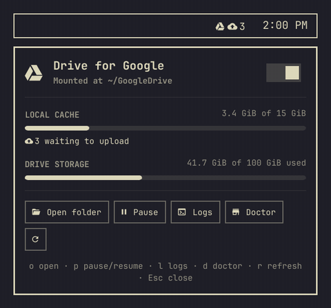
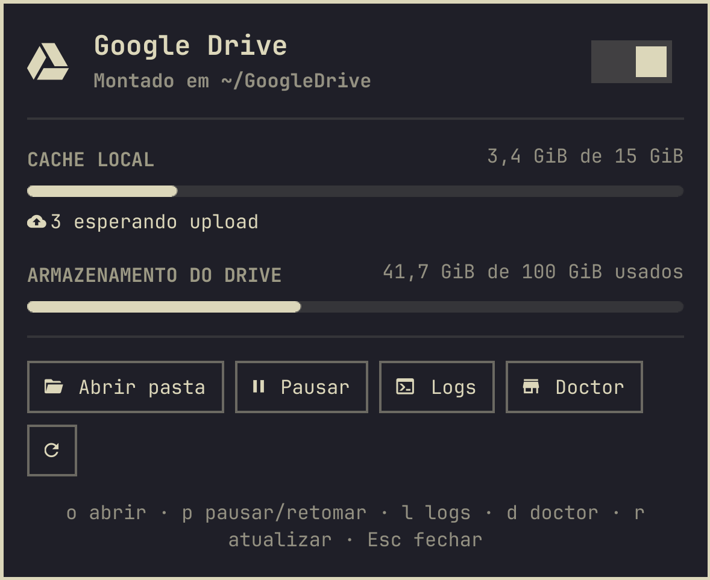
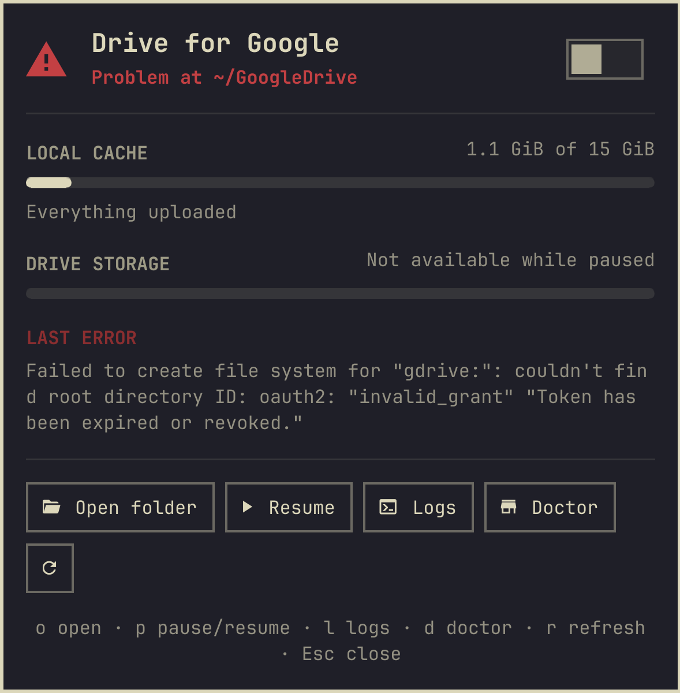

# Drive for Google

[🇺🇸 English](README.md) · **🇧🇷 Português (Brasil)**

O seu Google Drive no [Omarchy](https://omarchy.org), do jeito certo: o seu próprio cliente
OAuth, um mount do `rclone` que sobrevive a reinícios, um `doctor` que diz o que está errado
e um widget de barra para acompanhar tudo. Um comando guiado configura tudo, e rodar de novo
só muda o que estiver diferente.

Sem vínculo com o Google. Google Drive é uma marca registrada da Google LLC.

<p align="center"></p>

## O que você ganha

- **`omarchy-gdrive setup`**: um comando guiado e idempotente. Instala o `rclone` se faltar (a única coisa que roda como root, e só depois que você disser sim), te guia para criar **o seu próprio cliente OAuth do Google**, faz o login, escreve uma unit de *usuário* do systemd com cache VFS bem configurado, monta `~/GoogleDrive` e adiciona a pasta na barra lateral do gerenciador de arquivos. Rode de novo quando quiser: ele só muda o que estiver diferente.
- **Adota o que você já tem.** Já montou o Drive à mão com a sua própria `rclone-gdrive.service`? O `setup` detecta e oferece *adotar* sem mexer em nada (padrão) ou substituir pelo template.
- **`omarchy-gdrive doctor`**: ferramentas, permissões da config, remote, `client_id` próprio ou compartilhado, rede, token, unit, mount, cache, uploads pendentes, favorito. Diz o que rodar para corrigir cada item. `--fix` aplica as correções seguras.
- **`status`, `start`, `stop`, `restart`, `logs`, `quota`, `open`, `remove`**, e `status --json` para scripts.
- **Widget de barra**: ícone de estado (montado / pausado / problema), contador de uploads pendentes, popup com uso do cache, cota do Drive, chave de pausar/retomar e botões de logs e doctor. Segue o tema do Omarchy ao vivo. O clique abre `~/GoogleDrive`.
- **Nenhum segredo no lugar errado.** O `client_secret` vai direto para `~/.config/rclone/rclone.conf` (modo 600). Nunca passa pela linha de comando, nunca vai para o log e nunca aparece no widget. Veja [Privacidade e segurança](#privacidade-e-segurança).
- **Inglês e português**, seguindo o idioma do Omarchy (com fallback para `$LANG`).

<p align="center">
  
  
</p>
<p align="center">
  
</p>
<p align="center"><sub>As capturas e a demonstração usam dados fictícios do harness de desenvolvimento (<code>dev/run.sh docs</code>, <code>dev/run.sh gif</code>), não uma conta real.</sub></p>

## Instalação

```bash
omarchy plugin add https://github.com/gusthanks/omarchy-gdrive.git --enable
~/.config/omarchy/plugins/gusthx.gdrive/bin/omarchy-gdrive setup
```

Requisitos: Omarchy (Arch Linux), e `rclone`, `fuse3` e `jq`, que o `setup` oferece instalar
com o `pacman` (ele mostra o comando e pergunta antes).

O `setup` cria um link da CLI em `~/.local/bin`, então daí em diante basta `omarchy-gdrive …`. Escolha **direita** quando o plugin perguntar onde colocar o widget.

Não quer o widget? Clone o repositório em qualquer lugar e rode `bin/omarchy-gdrive setup`. A CLI não depende do shell.

### O que o `setup` faz, passo a passo

1. Se faltar `rclone`, `fuse3` ou `jq`, mostra o comando exato (`sudo pacman -S --needed --noconfirm …`) e pergunta antes de rodar. `--yes` responde por você; sem terminal e sem `--yes`, nada é instalado.
2. Procura uma `~/.config/systemd/user/rclone-gdrive.service` existente. Se você escreveu uma, oferece **Adotar** (nada muda, nada reinicia) ou **Substituir**.
3. Cria (ou reaproveita) o remote `gdrive` do rclone. Se você baixou um `client_secret_*.json` do Google, ele encontra o arquivo em `~/Downloads` e pergunta se pode usar. Se não, explica [por que você quer o seu próprio cliente](docs/own-client-id.pt-BR.md) e deixa você colar o id e o secret, ou seguir por enquanto com o cliente compartilhado do rclone.
4. Abre o navegador uma vez para a tela de consentimento do Google (`rclone config reconnect`).
5. Escreve a unit a partir de [`templates/rclone-gdrive.service`](templates/rclone-gdrive.service):
   `--vfs-cache-mode full`, cache limitado a 10 % do espaço livre no disco do cache (2–50 GiB), `--vfs-cache-max-age 72h`, `--dir-cache-time 72h`, `--poll-interval 1m`, `--umask 022`, `After=network-online.target`, reinício automático.
6. `systemctl --user enable --now`, espera o mount, adiciona o favorito do GTK, `chmod 600 rclone.conf`.

Tudo fica registrado em `~/.config/omarchy-gdrive/config` (remote, ponto de montagem, nome da unit, adotada ou gerenciada).

## Por que o seu próprio `client_id`

O rclone vem com um único `client_id` do Google, compartilhado por todos os usuários do rclone no mundo. O Google limita a velocidade dele (olá, `rateLimitExceeded`) e vai **aposentá-lo durante 2026**. Criar o seu leva cinco minutos, é grátis e te dá uma cota só sua. O guia mostra o Google Cloud Console clique a clique:

➡️ **[docs/own-client-id.pt-BR.md](docs/own-client-id.pt-BR.md)** · 🇺🇸 [in English](docs/own-client-id.md)

Já tem o mount com o cliente compartilhado? `omarchy-gdrive setup --client` troca o cliente no remote existente, sem refazer nada.

## Uso

### Comandos

| Comando | O que faz |
|---|---|
| `setup` | Instalação / reparo guiado. `--client`, `--credentials ARQ`, `--shared-client`, `--adopt`, `--replace`, `--remote`, `--mountpoint`, `--service`, `--yes` |
| `status [--json]` | Uma tela: estado, serviço, remote, cache, uploads pendentes |
| `doctor [--fix]` | Verificação completa, com o que rodar para corrigir; sai com código 1 só em falhas reais |
| `start` / `stop` / `restart` | Monta, desmonta (avisa sobre uploads pendentes), remonta |
| `logs [-n N] [--no-follow]` | `journalctl --user -u rclone-gdrive -f` |
| `quota [--json]` | Uso do Drive (`rclone about`) |
| `open` | Abre o mount no gerenciador de arquivos |
| `remove [--keep-remote] [--purge-cache]` | Desfaz tudo nesta máquina. **Nunca mexe nos arquivos do Drive.** |

### Widget de barra

| Ação | Resultado |
|---|---|
| Clique esquerdo | Abre `~/GoogleDrive` |
| Clique direito | Abre o menu |
| Clique do meio | Pausa / retoma o mount |
| Teclas no menu | `o` abrir · `p` pausar/retomar · `l` logs · `d` doctor · `r` atualizar · `Esc` fechar |

## Configuração

Prefere o menu no clique esquerdo? Em `~/.config/omarchy/shell.json`:

```json
{ "id": "gusthx.gdrive", "leftClick": "panel" }
```

O widget atualiza a cada 15 s (a cada 4 s com o menu aberto); use `"pollSeconds"` para mudar (mínimo 3). Cada atualização é leve: o `status` só lê a config do rclone quando o `rclone.conf` mudou, e guarda só dois fatos sim/não (o remote existe, cliente próprio) em `$XDG_RUNTIME_DIR`, nunca um token.

IPC: `quickshell -p /usr/share/omarchy/shell ipc call gusthx.gdrive toggle` (também `open`, `close`, `refresh`, `openFolder`, `toggleMount`).

## Estrutura

| Caminho | Para quê |
|---|---|
| `bin/omarchy-gdrive` | Ponto de entrada da CLI e o fluxo do `setup` |
| `lib/common.sh` | Tudo que *não* é específico do Google: unit do systemd, mount, cache, favorito, doctor, remove |
| `lib/gdrive.sh` | Google Drive: cliente OAuth, detecção do cliente compartilhado, cota |
| `lib/i18n.sh`, `i18n/cli/*.json` | Mensagens da CLI (en, pt-BR) |
| `templates/rclone-gdrive.service` | A unit que o `setup` gera |
| `Panel.qml` | Widget de barra: roda a CLI, guarda o estado, o ícone e a moldura do popup |
| `DriveView.qml` | O conteúdo do popup (lê tudo de um objeto `drive`) |
| `Model.js`, `i18n/*.json` | Funções do widget e textos (o catálogo próprio do plugin: en, pt, pt-BR) |
| `dev/` | Harness de desenvolvimento isolado com dados fictícios, testes, script de deploy |
| `docs/` | O guia do `client_id` nos dois idiomas, capturas de tela |

A divisão é de propósito: o `common.sh` só conhece "um remote do rclone montado por uma unit de usuário", então outro provedor de nuvem (OneDrive, Dropbox, S3) fica a um segundo módulo de distância.

## Privacidade e segurança

O Drive for Google não tem servidor próprio nem telemetria. Seus arquivos vão da sua máquina para o Google, pelo rclone.

**O que fica onde**

| Caminho | O quê | Permissões |
|---|---|---|
| `~/.config/rclone/rclone.conf` | O remote: `client_id`, `client_secret` e o token OAuth (escritos pelo rclone e pelo `setup`) | arquivo `600`, pasta `700`; `setup` e `doctor --fix` garantem isso |
| `~/.config/omarchy-gdrive/config` | Nome do remote, ponto de montagem, nome da unit, adotada ou gerenciada. Sem segredos | seu umask |
| `~/.config/systemd/user/rclone-gdrive.service` | A unit do mount. Sem segredos | seu umask |
| `~/.cache/rclone/vfs/<remote>/`, `vfsMeta/` | Cópias locais do rclone dos arquivos que você abriu ou salvou, até subirem e expirarem (72 h, com limite de tamanho) | `700` (o rclone cria privadas) |
| `$XDG_RUNTIME_DIR/omarchy-gdrive/status-remote` | Dois fatos sim/não para a barra (o remote existe, cliente próprio) e um checksum. Nunca um token, id ou secret. Só na RAM, some no reinício | pasta `700`, arquivo `600` |
| `~/.config/gtk-3.0/bookmarks` | Uma linha para a barra lateral do gerenciador de arquivos | sem mudança |
| `~/.local/bin/omarchy-gdrive` | Um link simbólico para a CLI | — |
| o journal do usuário | O log do rclone no nível `NOTICE` (erros podem citar arquivos do seu Drive) | seu journal |

**Como o secret é tratado**

- Você digita o `client_secret` sem eco na tela, ou o `setup` lê do `client_secret_*.json` que você baixou.
- Ele é escrito no `rclone.conf` por um arquivo temporário criado com modo `600` ao lado dele. Nunca vai para a linha de comando (então não aparece no `ps` nem no histórico do shell), nunca vai para o log e nunca aparece no widget. Depois de usar um JSON baixado, o `setup` lembra que o arquivo ainda guarda uma cópia que você pode apagar.
- O `client_id` é passado como argumento para `rclone config create/update`. É um identificador público, não um segredo.
- O `status --json` (o que o widget lê) não carrega token, id nem secret. A última linha de erro do journal passa por uma limpeza de qualquer coisa que pareça token ou secret antes de aparecer.
- O `remove` apaga o remote (e o token dele) do `rclone.conf` depois de perguntar. Para revogar o acesso do lado do Google também, use [Conta do Google → Segurança → Conexões de terceiros](https://myaccount.google.com/connections).

**Servidores contatados**

| Servidor | Por quem | Quando |
|---|---|---|
| `www.googleapis.com` | rclone | o mount, `quota` (quando o popup abre, no máximo a cada 15 min), `doctor` |
| `oauth2.googleapis.com`, `accounts.google.com` | rclone, seu navegador | login e renovação do token |
| `127.0.0.1:53682` | rclone, seu navegador | só durante o login: a página local do rclone que recebe a resposta do Google |
| `www.googleapis.com/discovery/v1/apis` | `doctor` (curl) | um teste de alcance; não envia nada sobre você |
| seus mirrors do Arch | `pacman` | só se faltar `rclone`, `fuse3` ou `jq`, depois de perguntar |

O widget de barra em si não faz requisições de rede. Ele roda `omarchy-gdrive status --json` (só local: systemd, o mount, a pasta do cache) e, quando o popup abre, `quota --json`, que pergunta ao Google pelo rclone.

Nada aqui roda como root além daquela chamada do `pacman`. O mount só é visível para você (sem `allow_other`).

## Desenvolvimento

Trabalhe num clone deste repositório, nunca na cópia instalada em
`~/.config/omarchy/plugins/` (salvar lá recarrega a sua barra). O `dev/run.sh` sobe uma
instância **separada** do Quickshell com as bibliotecas `Commons`/`Ui` do Omarchy, este
repositório e dados fictícios de `dev/MockDrive.qml`: ele nunca roda a CLI, nunca chama o
rclone e nunca lê a sua config. As capturas são renderizadas fora da tela, então nada aparece
no seu desktop.

```bash
dev/run.sh test      # Model.js, catálogos i18n, escrita do client-secret, pergunta antes do sudo, bash -n
dev/run.sh check     # compila todos os tipos QML, Panel.qml incluído
dev/run.sh docs      # gera de novo docs/*.png com dados fictícios (fora da tela)
dev/run.sh gif       # docs/demo.gif (demonstração roteirizada, precisa do ffmpeg)
dev/run.sh preview   # o popup numa janela, dados fictícios
omarchy plugin validate .
dev/deploy.sh        # avança a cópia instalada até o HEAD e reinicia o shell uma vez
```

Veja o [AGENTS.md](AGENTS.md) (em inglês) para as regras que agentes de IA (e humanos) seguem aqui.

## Desinstalação

```bash
omarchy-gdrive remove
omarchy plugin remove gusthx.gdrive
```

## Mudanças

Veja o [CHANGELOG.md](CHANGELOG.md) (em inglês).

## Créditos

Feito sobre o [rclone](https://rclone.org/) (MIT). O widget usa as bibliotecas de shell do
Omarchy (`Commons`, `Ui`), importadas em tempo de execução do Omarchy instalado, não copiadas
para este repositório.

## Licença

MIT. Veja [LICENSE](LICENSE). Copyright (c) 2026 Gustavo Costa (gusthx).
